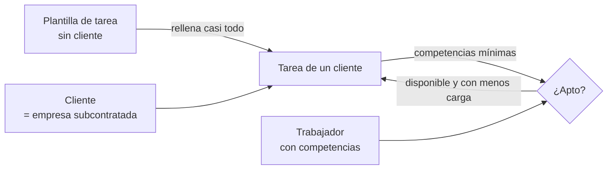

# MOC - Prototipo

## Qué es y para qué sirve
Primera versión de Pulpo (Flutter web) hecha a partir de los croquis de `Pulpo/Prototipo/`. Sirve para fijar la **personalidad visual** (estilo Holded: claro, minimalista, etiquetas de color, paneles laterales) y el **modelo básico**: clientes → tareas ← trabajadores, unidos por competencias.

## Flujo conceptual

## Pantallas (croquis 1-4)
- **Inicio**: KPIs + selector de vista (como el de Clientes), abre con `?v=0..2`:
  - **Días** (principal, `vista_dias.dart`): calendario en horizontal (`PageView`), un bloque por día con hoy en el centro. Como mucho ~3,4 días a la vista (mín. 340 px). **Línea de tiempo abajo**: raya neutra continua y punto con aro encima (el fondo del aro tapa la raya). Dentro, bloques por cliente con sus tareas. Pasado apagado (historial). De −90 a +400 días.
  - **Imán**: `ImanPorDias` (física propia; `pageSnapping: false`) deja correr la inercia y encaja con un muelle en el día más cercano. Trackpad: al parar se centra (temporizador de 140 ms). Rueda vertical: un día por golpe (`pointerSignalResolver`). Lo cubren 3 tests en `inicio_test.dart`.
  - Gotcha: la caja de la línea de tiempo necesita `width: double.infinity`; si no, el `Stack` mide lo que el punto y la raya sale a trozos.
  - **Calendario** (`vista_calendario.dart`): mes por bloques; cada día muestra sus clientes ("+N más" si no caben). Al pulsar un día salta a ese día en Días.
  - **Tablero** (secundaria): Realizadas · Actual (✓ "hecha hoy") · Futuro. En Actual, botón **🐙 Automatizar** → `Store.automatizar`: asigna el mejor trabajador apto a lo que no tiene.
  - Qué tarea cae en qué día: `Store.tareasDelDia`. Pasado = `ultimo` ese día; hoy = hecho hoy + lo que toca + vencido; futuro = `proximo` ese día.
- **Clientes**: vista en bloques grandes o en lista tipo Holded; buscar y filtrar por Activo/Inactivo. Al pulsar → ficha + sus tareas.
- **Trabajadores**: tarjetas con avatar, estado de hoy, competencias; filtrar por estado y competencia.
- **Tareas**: todas; pestañas Todas / Plantillas / De clientes; filtro por tipo.
- **Empresa propia**: en el menú como "Pronto" (el usuario dijo que todavía no).
- Crear/editar = **ventana centrada** que sube desde abajo, arrastrable por la cabecera; botón para **acoplarla a la derecha** y volver (`VentanaFormulario` en `forms.dart`; el modo se recuerda en `_acoplada`). Lo secundario va en `MasDetalles` (plegable).
- **Nueva tarea** desde un cliente → va fija a ese cliente. Solo desde la vista Tareas se elige cliente o "Sin cliente (plantilla)".

## Modelo (campos de los croquis)
- **Cliente**: nombre, CIF/NIF, dirección fiscal, ciudad, CP, provincia, teléfono, email, persona y teléfono de contacto, notas, activa, fecha de alta (+ color).
- **Trabajador**: nombre, apellidos, teléfono, email, info básica, competencias, títulos/capacidades, activo, estado de hoy (disponible/ocupado/ausente).
- **Tarea** ("máquina" en el croquis): nombre, tipo, marca, modelo, nº serie, ubicación, instalación, estado de la máquina, último/próximo mantenimiento, periodicidad, notas, activa + **competencias mínimas**, trabajadores asignados, cliente (vacío = plantilla).

## Automatización (primer paso)
- Apto = tiene **todas** las competencias de la tarea y está activo. Al elegir tipo se añade su competencia habitual.
- "Asignar automáticamente" / al aplicar plantilla: apto, disponible hoy y con menos tareas (`Store.mejorPara`).

## Archivos clave
- `app/lib/models.dart` — modelo, enums, fechas (`masDias`: suma de días sin el fallo del cambio de hora)
- `app/lib/store.dart` — datos (shared_preferences), aptos, datos de ejemplo
- `app/lib/forms.dart` — panel lateral y formularios
- `app/lib/shell.dart` — menú lateral; `?s=0..3` abre una sección, `&c=<id>` un cliente
- `app/lib/screens/` — inicio, clientes, cliente_detalle, trabajadores, tareas, tarea_card
- `app/lib/theme.dart` — colores, tipos (icono/color) y lista de competencias

## Gotchas
- `GoogleFonts.interTextTheme` no compila con Flutter 3.47 (usa el `TextTheme` de `material_ui`) → se usa `fontFamily: GoogleFonts.inter().fontFamily`.
- `AnimatedSwitcher` centra a sus hijos: hay que darle un `layoutBuilder` con `StackFit.expand`.
- Desplegables en media columna → `isExpanded: true`.
