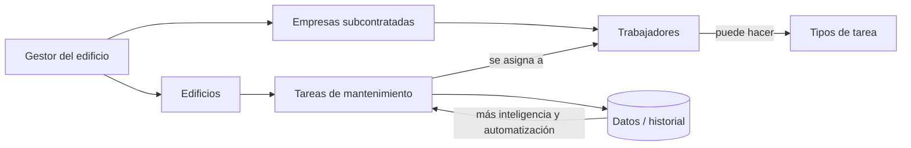

# MOC - Visión

## Qué es y para qué sirve
El producto visto desde el usuario: a quién sirve, qué problema le quita y qué tiene que hacer. Es la referencia para decidir qué entra en el prototipo y qué se deja para después.

## Flujo conceptual

## Notas
- [[01 - Qué es]] — problema, usuarios, propuesta de valor
- [[02 - Funcionalidades]] — prototipo vs. después
- [[03 - Preguntas abiertas]] — lo que aún no está decidido

## Archivos clave
— aún no hay código
